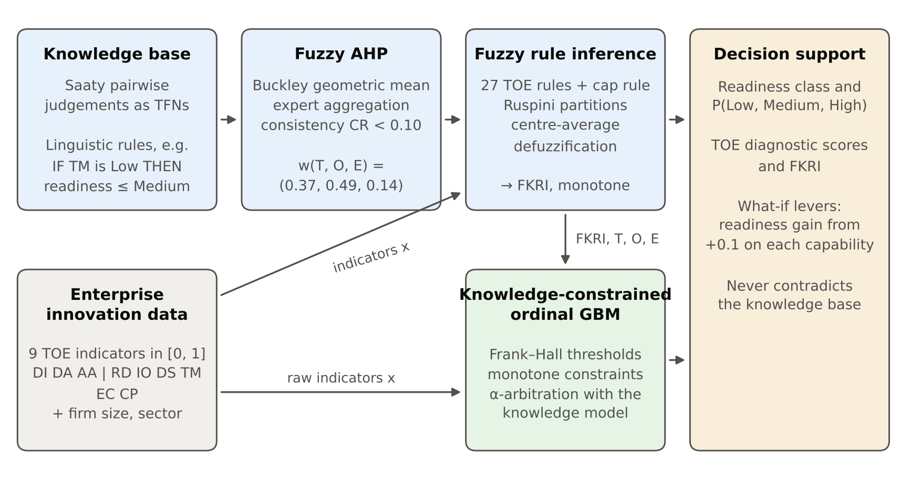
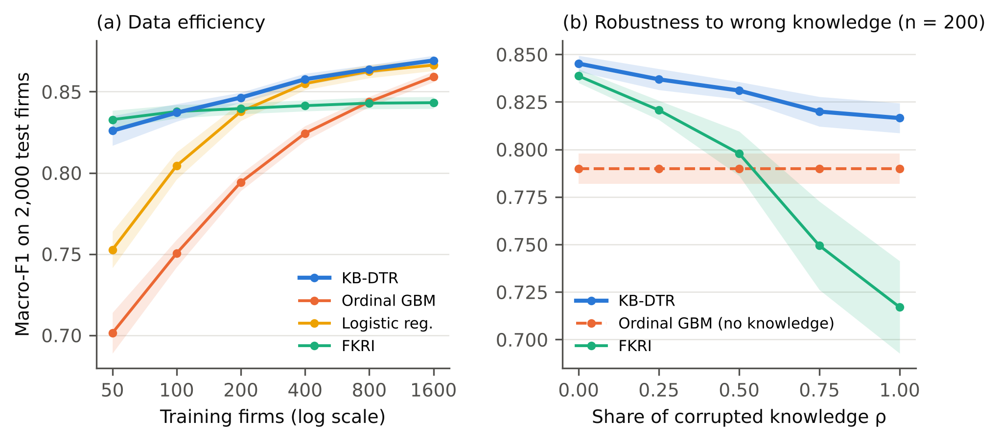

# KB-DTR: knowledge-based AI decision support for digital-transformation readiness

Code for the short communication **"A Knowledge-Based AI Decision-Support Model for Predicting Digital Transformation Readiness from Enterprise Innovation Data"** (prepared for *Knowledge-Based Systems*, Elsevier).

KB-DTR combines expert knowledge with enterprise innovation data in four layers:

1. **Fuzzy AHP** (Buckley's method, with multi-expert aggregation) derives the weights of 9 TOE criteria.
2. **Fuzzy rule inference** (27 TOE rules plus a top-management cap rule) produces a *Fuzzy Knowledge Readiness Index* (FKRI). The FKRI is monotone by construction.
3. A **knowledge-constrained ordinal gradient-boosting** learner uses the raw indicators and the knowledge features, under monotonicity constraints. A **knowledge–data arbitration** step then decides, by cross-validation, how much to trust the experts versus the data.
4. A **decision-support** layer reports, for each firm, its readiness class, class probabilities, TOE diagnostic scores and ranked *what-if* improvement levers. None of these outputs can contradict the knowledge base.



## Files

| File | What it is |
| --- | --- |
| `kbdt.py` | The whole model: criteria, fuzzy AHP, fuzzy inference, all models, metrics, decision support, benchmark simulator, CLI |
| `run_experiments.py` | Reproduces every table, figure and number in the paper |
| `test_kbdt.py` | Tests for each guarantee the paper claims (weights, consistency, monotonicity, cap rule, probabilities) |
| `tune.py` | Cross-validated hyperparameter search for KB-DTR |
| `firms.csv` | **Example data: 300 simulated firms** for trying every command. Replace it with your real survey data. |
| `firms_template.csv` | Empty file with the 12 required columns for your real data |
| `results/` | Generated outputs: paper tables (`table1_knowledge.csv`, `table2_performance.csv`), figures (`fig1_framework.png`, `fig2_results.png`), raw runs (`runs.csv`, `summary.json`), and the example-data outputs `evaluate_firms.txt` (5-model repeated CV), `scored_firms.csv` (readiness and top lever for each firm) and `tune_firms.txt` (hyperparameter search) |

## Quick start

```bash
pip install -r requirements.txt
python kbdt.py knowledge          # criterion weights, consistency ratios, the 27-rule base
python kbdt.py demo               # decision-support reports for 3 simulated firms
python run_experiments.py         # full protocol: 20 repetitions (~10 min on 2 cores)
python run_experiments.py --from-runs   # rebuild tables and figures from results/runs.csv
python -m pytest -q
```

## Run everything in one command (e.g. on a RunPod CPU pod)

```bash
git clone https://github.com/saching1302/KB-Dtr.git && cd KB-Dtr && pip install -q -r requirements.txt && python -m pytest -q && python run_experiments.py --repeats 20 --jobs -1 && python tune.py && python kbdt.py evaluate firms.csv --label readiness --repeats 10 | tee results/evaluate_firms.txt && python kbdt.py assess firms.csv --out results/scored_firms.csv
```

> `firms.csv` in this repo is **simulated**. Use it to learn the workflow, but never report its numbers as real-firm evidence.

## Use it on your own firms

Prepare a CSV with one row per firm. Blank cells are allowed.

| Column | Meaning | Scale |
| --- | --- | --- |
| `DI` `DA` `AA` | Digital infrastructure, data and analytics capability, AI and automation adoption | 0–1 |
| `RD` `IO` `DS` `TM` | R&D intensity, innovation output, digital skills, top-management support | 0–1 |
| `EC` `CP` | Ecosystem collaboration, digital market pressure | 0–1 |
| `size` | 0 = micro, 1 = small, 2 = medium, 3 = large | integer |
| `sector` | Free text, e.g. Manufacturing | text |
| `readiness` | Only needed for `evaluate`: 0 = Low, 1 = Medium, 2 = High | integer |

Likert items (1–5 or 1–7) can be rescaled with `(x - min) / (max - min)`.

```bash
python kbdt.py assess firms.csv --out scored.csv           # knowledge model only, no labels needed
python kbdt.py evaluate firms.csv --label readiness        # repeated 5-fold CV of all models on your data
```

**Using your own expert panel.** Replace the pairwise judgements in `REFERENCE_JUDGEMENTS` in `kbdt.py`, using one dictionary per expert. The fuzzy AHP weights, consistency ratios, rule consequents and every model update automatically.

## Results (controlled benchmark, 20 repetitions, 2,000 test firms)

| Model | Macro-F1, n = 200 | Macro-F1, n = 1,600 | Knowledge violations (MVR) |
| --- | --- | --- | --- |
| Fuzzy-AHP weighted sum (knowledge only) | 0.850 | 0.851 | 0.0 % |
| FKRI: fuzzy AHP + rules (knowledge only) | 0.840 | 0.843 | 0.0 % |
| Logistic regression | 0.838 | 0.866 | 0.0 % |
| Random forest | 0.805 | 0.856 | 12.2 % |
| Ordinal GBM | 0.794 | 0.859 | 9.5 % |
| **KB-DTR (proposed)** | **0.846** | **0.869** | **0.0 %** |

With 1,600 firms, KB-DTR is significantly better than every alternative (Wilcoxon test, Holm-adjusted p < 0.05). With 200 firms, it ties the best expert model. It never contradicts the knowledge base. If the expert knowledge is fully corrupted, it still beats knowledge-free boosting (0.816 vs 0.790). The full ablation is in `results/table2_performance.csv`.



**About the data.** The benchmark is a *simulated* enterprise innovation survey. Its generating process differs on purpose from the knowledge base: the true weights differ, and it contains capability interactions that no rule encodes. This design makes it possible to control knowledge quality, which field data cannot do. Before you draw empirical conclusions, validate the model on real firm-level data (for example your own survey, the Community Innovation Survey, or the World Bank Enterprise Surveys) using `python kbdt.py evaluate`.

## Citation

```bibtex
@article{kbdtr2026,
  title   = {A Knowledge-Based AI Decision-Support Model for Predicting Digital Transformation Readiness from Enterprise Innovation Data},
  author  = {Gujjalwar, Sachin},
  journal = {Knowledge-Based Systems},
  note    = {Short communication, under review},
  year    = {2026}
}
```

## License

MIT
